# UPI Offline Mesh Demo

An educational payment-systems prototype that explores how a small, encrypted payment instruction can be carried across an offline device mesh and reconciled when a bridge node reconnects.

> **Demo only. This project does not connect to UPI, a bank, NPCI, or real funds.** It is not suitable for financial use. Browser queueing, the sandbox PIN (`1234`), demo RSA keys, and the simulator are not production security controls.

## What it demonstrates

- Browser-side hybrid encryption using RSA-OAEP/SHA-256 and AES-256-GCM.
- Local queueing of encrypted test packets using backend-fetched recipients and a cached server public key.
- A software mesh simulator that gossips packets between virtual devices.
- Bridge ingestion, packet freshness checks, tamper detection, and duplicate suppression.
- A local H2 / deployed Render Postgres demo ledger that atomically updates seeded sandbox accounts after backend verification.
- A responsive dashboard showing devices, account balances, settlement history, and activity.

## Demo flow

1. Start the app and open `http://localhost:8080` once while online. The browser caches the dashboard, demo recipient list, and server's public key for later offline queueing.
2. Choose demo accounts and enter a test amount and the sandbox PIN `1234`. The browser encrypts the payment instruction and stores the packet locally. A queued packet is **not** a payment or a promise that settlement will succeed.
3. If the browser is online, **Sync queued packets** sends the packet to the simulated mesh. If offline, the browser keeps it queued until it can reconnect.
4. From the payment status or Mesh Devices, run gossip to copy packets to virtual nodes, then upload bridge packets for verification.
5. Inspect the account balances and transaction ledger to see the simulated settlement or rejection.

On Render, the sandbox server keypair is stored in Postgres so queued packets can still be decrypted after a normal service restart. Local development uses in-memory H2, so its key resets when the app restarts. The local queue is stored in browser local storage and is not protected against device compromise or user modification. Demo account details and the public key must be fetched while online before they are available for a fresh offline session.

## Architecture

```mermaid
flowchart LR
    A[Browser demo client] -->|RSA-OAEP wraps AES key; AES-GCM encrypts instruction| Q[Local encrypted packet queue]
    Q -->|sync when online| M[Virtual mesh simulator]
    M -->|gossip rounds| B[Bridge node]
    B -->|HTTP ingest| I[Idempotency and validation]
    I --> L[Demo ledger in H2 locally / Postgres on Render]
    L --> D[Dashboard balances and history]
```



## Tech stack

- Java 17, Spring Boot 3.3, Spring MVC, Spring Data JPA
- H2 locally; Render Postgres for deployed demo data
- Thymeleaf and browser Web Crypto API
- Maven, Docker, Render Blueprint

## Run locally

Prerequisites: JDK 17+ and network access on first run so Maven Wrapper can download Maven and dependencies.

Windows PowerShell:

```powershell
.\mvnw.cmd spring-boot:run
```

macOS/Linux:

```bash
./mvnw spring-boot:run
```

Then visit `http://localhost:8080`. The wrapper may need network access on first run. If Maven is already installed, `mvn spring-boot:run` also works.

## Build and tests

```bash
./mvnw clean package
./mvnw test
```

On Windows, use `mvnw.cmd`. The included concurrency tests cover encrypted round trips, tamper rejection, and duplicate delivery. The browser offline path requires a secure context; localhost and HTTPS deployments qualify.

## Deploy a demo on Render

This repository includes a Dockerfile and `render.yaml` for a small public demo service.

1. Push this repository to GitHub.
2. In Render, choose **New → Blueprint** and connect the repository.
3. Review the `upi-offline-mesh-demo` service and create it on the Free plan.
4. Wait for the Docker build and health check at `/health` to pass. Render will provide an `onrender.com` URL.

Local development uses in-memory H2. The Render Blueprint provisions a same-region Postgres database connected over Render's private network, so ledger records survive normal app restarts and deploys. Render's Free Postgres plan expires 30 days after creation; upgrade the database before then if you need to retain data long term. Render Free web services can spin down after idle periods. Do not enter real PINs or personal data.

## API overview

| Method | Path | Purpose |
|---|---|---|
| `GET` | `/` | Interactive demo dashboard |
| `GET` | `/health` | Host health check |
| `GET` | `/api/server-key` | Current demo RSA public key |
| `GET` | `/api/accounts` | Seeded demo accounts |
| `GET` | `/api/dashboard/summary` | Backend account and transaction totals |
| `GET` | `/api/transactions` | Simulated settlement and rejection ledger |
| `POST` | `/api/mesh/inject` | Inject an already-encrypted demo packet |
| `POST` | `/api/mesh/gossip` | Run one simulated gossip round |
| `POST` | `/api/mesh/flush` | Send bridge-held packets to the demo ledger |
| `POST` | `/api/mesh/reset` | Reset mesh and idempotency cache |
| `POST` | `/api/bridge/ingest` | Demo bridge ingestion pipeline |

## Important limitations

This is not an implementation of UPI Lite, UPI Lite X, Bluetooth/NFC device-to-device communication, or a bank wallet. Device identities and keys are not hardware-backed; offline spending limits are not enforced by a trusted wallet; the virtual mesh and duplicate cache are process-local; the local H2 database resets when the app restarts; the PIN is only a demo field; and there is no bank/PSP/NPCI integration, customer authentication, or production audit trail. Offline acceptance here means only that the browser can queue an encrypted test packet locally. Backend settlement happens later and may reject it.

A real-money product would require a regulated payment partner, an approved payment design, secure wallet provisioning and device-bound controls, durable settlement/idempotency storage, monitoring, audits, and integration/certification outside this codebase.

## Resume description

> Built an educational offline-payment mesh simulator with browser-side hybrid encryption, browser-local packet queueing, simulated gossip routing, and idempotent backend reconciliation using Spring Boot, Java, Web Crypto, and H2.

Use “simulator” or “prototype” in a portfolio description; do not describe it as live UPI or real-money payment software.
